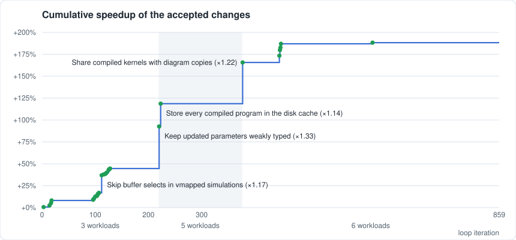
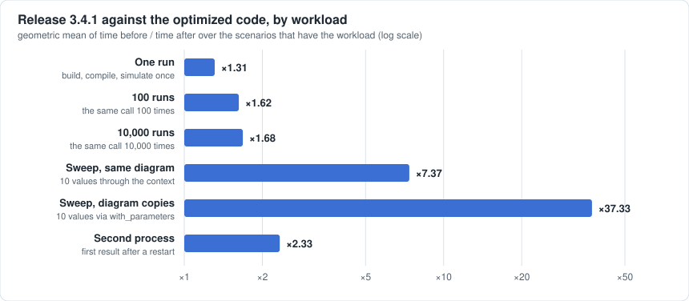

# Case study: an optimization loop that measures before it commits

Between releases 3.4.1 and 3.5.0, Jaxonomy's
simulation core was made faster by 27 small changes. None of them was
committed on a hunch. Each one was proposed, applied to a scratch copy,
checked against reference results, timed against the unchanged code, and
only then kept. Most proposals were thrown away.

This page describes how that loop works, what it kept, what it got wrong,
and how far the headline number can be trusted. It is written for readers
who have not seen the code.

## The result in two numbers

**+188% if you multiply the steps.** Each accepted change came with a
measured speedup. Multiplying the 27 of them gives &#215;2.88.



**+188% if you measure once, start to finish.** The steps above were
measured at different times, and what was measured grew along the way (see
[What "faster" means here](#what-faster-means-here)). So we also ran one
plain comparison at the end: release 3.4.1 against the optimized code, same
machine, same day, stock JAX 0.9.2. The optimized code is &#215;2.88
faster on the geometric mean over 180 timed situations.



The second number is the one to quote. The spread behind it matters more
than the average:

| Workload | What is timed | Speedup |
|---|---|---|
| One run | build, compile, simulate once | &#215;1.31 |
| 100 runs | the same call 100 times | &#215;1.62 |
| 10,000 runs | the same call 10,000 times | &#215;1.68 |
| Sweep, same diagram | 10 values through the context | &#215;7.37 |
| Sweep, diagram copies | 10 values via with_parameters | &#215;37.33 |
| Second process | first result after a restart | &#215;2.33 |

Read it as: what you do *after* the first run got much faster; the first run
itself got moderately faster.

By model family, the picture is uneven. On the original three workloads
(one run and repeats), event-driven and block-heavy models barely moved,
while stiff and batched ones gained most:

| Family | One run and repeats | All workloads |
|---|---|---|
| Bouncing balls | &#215;1.05 | &#215;2.44 |
| Spring-mass chain | &#215;1.07 | &#215;2.19 |
| Discrete PID loops | &#215;1.25 | &#215;2.85 |
| Neural ODE | &#215;1.26 | &#215;3.18 |
| Acausal RC ladder | &#215;1.76 | &#215;3.53 |
| Brusselator grid | &#215;2.73 | &#215;3.17 |
| Van der Pol ensemble | &#215;2.89 | &#215;3.18 |

12 of the 180 situations came out slightly slower, none by more than
3%.

## What "faster" means here

A speedup is only as meaningful as the thing that was timed. The loop times
a fixed grid of **scenarios** under several **workloads**.

Scenarios are seven model families, each in three sizes, most of them once as
a plain simulation and once as a gradient computation (33 in the loop, 6 more
held back to check that gains carry over):

| Family | What it stresses |
|---|---|
| Spring-mass chain built from primitive blocks | many small blocks: tracing and compiling |
| Acausal RC ladder | symbolic preprocessing and the implicit (BDF) solver |
| Bouncing balls | zero-crossing events |
| Discrete PID loops at three rates | periodic updates and event scheduling |
| Brusselator reaction-diffusion grid | a stiff ODE: Jacobians and linear solves |
| Neural ODE | a learned right-hand side |
| Van der Pol ensemble | `vmap` over thousands of initial states |

Workloads are what a user does with a model:

| Workload | What is timed |
|---|---|
| One run | build the model, compile, simulate once |
| 100 runs, 10,000 runs | the same, then the same call repeated |
| Sweep, same diagram | ten more runs with another parameter value and initial state, changed through the context |
| Sweep, diagram copies | the same ten runs with the parameter changed on the diagram (`Diagram.with_parameters`) |
| Second process | build and first result in a fresh process that may reuse what the first one left on disk (`enable_persistent_jit_cache`) |

The score is the geometric mean, over every scenario and workload pair, of
*time before / time after*. Every pair weighs the same.

The loop started with the first three workloads only. The two sweep
workloads and the second process were added later, when it became clear
that a user's second run (the same system with other parameters) was not
being measured at all. That decision produced the three largest steps in the
chart. It also means the product of steps mixes two things: making measured
things faster, and starting to measure things that were slow.

## How the loop works

```
profile  ->  hypothesis  ->  patch  ->  apply and lint  ->  results unchanged?
                                                                  |
commit  <-  tests pass?  <-  measure again  <-  guardrails  <-  faster than noise?
   |
replicate later, against the parent commit
```

1. **Profile.** Where does time go, per source line, in each phase: building
   the model, tracing, compiling, running?
2. **Hypothesis.** A specific claim about a specific place: "this is computed
   once per event and could be computed once per period".
3. **Patch.** A small diff. It may only touch library code, and a lint
   refuses changes to precision, solver tolerances, validation, caching
   switches, or anything that could detect that it is being timed.
4. **Results unchanged.** Every scenario's outputs (final states,
   trajectories, event times, gradients) are compared with reference outputs
   recorded in advance, within fixed tolerances.
5. **Faster than noise.** The patched and the unchanged code are run back to
   back, in fresh processes, in alternating order, so that a warm or busy
   machine affects both alike. The gain has to exceed three times the
   measured run-to-run noise (0.4% here).
6. **Guardrails.** No single scenario may get more than 5% slower, memory
   may not grow by more than 15%, and nothing may start compiling more often.
7. **Measure again.** A second, independent measurement has to confirm the
   gain before anything is committed.
8. **Tests.** About 3,700 tests of the library have to pass.
9. **Replicate.** Later, the commit is measured once more against its parent
   with twice the passes. One that does not replicate is flagged.

Who writes the patches? Two sources. A small open-weights model running on
the same machine (Qwen, served by LM Studio) proposed diffs around the
clock. Separately, in supervised review sessions, Claude read the profiles
and wrote patches directly, each verified before it was queued. The gates
above are identical for both, and are plain code: no model decides whether a
change is accepted.

## What was accepted

859 attempts over four weeks: 28 accepted (one of them later removed, see
below), 591 rejected for not being faster than noise or for tripping a
guardrail, 207 invalid (did not apply, crashed, or changed results), 25
interrupted, 8 set aside as faster overall but slower somewhere.

The 27 kept changes fall into five groups. Speedups are on the whole grid as
it was when the change was accepted; "replicated" is the later independent
measurement.

**Do not compile again for a follow-up run**

| Change | Speedup | Replicated |
|---|---|---|
| A parameter changed through the context keeps its weak type, so the first new value reuses the compiled kernel | &#215;1.332 | &#215;1.333 |
| A `with_parameters` copy runs on the kernel of the diagram it was copied from | &#215;1.215 | &#215;1.216 |
| The opt-in disk cache stores every compiled program, not only those that took a second to compile | &#215;1.135 | &#215;1.133 |

**Do not compute what is thrown away**

| Change | Speedup | Replicated |
|---|---|---|
| Under `vmap`, recording loops stop selecting over whole buffers | &#215;1.172 | &#215;1.168 |
| BDF: rescale the step only when it is rejected | &#215;1.029 | &#215;1.028 |
| BDF: compute order changes only when due | &#215;1.027 | &#215;1.028 |
| BDF: factorize the matrix only when needed | &#215;1.018 | &#215;1.017 |
| Zero-crossing bisection ends once resolved; cotangent severing is skipped without autodiff | &#215;1.007 | &#215;1.008 |

**Do it once, not once per block or per event**

| Change | Speedup | Replicated |
|---|---|---|
| MLP weights are built in one compiled call | &#215;1.025 | &#215;1.013 |
| The initial-condition Jacobian is compiled once | &#215;1.011 | &#215;1.012 |
| Event conditions capture only the state they read | &#215;1.009 | &#215;1.011 |
| Port order is cached; equation checks are bucketed | &#215;1.008 | &#215;1.005 |
| Ports are refreshed only where an update can reach | &#215;1.008 | &#215;1.008 |
| Seven smaller ones (three in the acausal compiler's alias substitution, static data initialized once, next sample times shared across equal periods, adjoint checkpoints written one row at a time, eager calls compiled once) | &#215;1.004 to &#215;1.008 each | &#215;1.004 to &#215;1.008 |

**Make a new diagram or context cheap**

These matter most for parameter sweeps through `Diagram.with_parameters`,
where every value copies the diagram and builds a context.

| Change | Speedup | Replicated |
|---|---|---|
| The consistent initial conditions of an acausal system are set up once and shared by its copies | &#215;1.029 | &#215;1.029 |
| MLP blocks share one compiled evaluation program instead of compiling one per block and per copy | &#215;1.023 | &#215;1.024 |
| Debug log messages are formatted only when debug logging is on | &#215;1.015 | &#215;1.014 |
| Building a context avoids a quadratic membership test and needless array copies | &#215;1.010 | &#215;1.009 |
| MLP blocks use that shared program for traced calls too | &#215;1.005 | &#215;1.006 |

**Do less on every call**

| Change | Speedup | Replicated |
|---|---|---|
| The final state is checked for NaN on the host instead of with one device round trip per state | &#215;1.022 | &#215;1.020 |
| Repeated calls skip three walks over every block | &#215;1.007 | &#215;1.004 |

25 of the 27 replications cleared the acceptance bar on their own. Two
small ones (the per-call walks, and one alias-substitution change) came back
at +0.4%, just under it. They were kept after review, because the work they
remove is certainly no longer done; their size is the uncertain part.

The full list with dates is in `benchmarks/perf_loop/accepted_changes.json`.

Four changes in the same period were made by hand, outside the loop, which
may not change results, tests or dependencies:

- **The BDF solver keeps its Jacobian across steps for pure ODEs.** This
  changes results within solver tolerance, so it needed a person to approve
  new reference outputs for the stiff scenarios. In the end-to-end comparison the stiff reaction-diffusion scenarios run
  1.6 to 7.1 times faster when repeated, more so on larger grids.
- **A correctness fix found on the way.** A compiled simulation kept running
  the old program after a parameter change that reconfigured a block (a PID
  gain moving to or from zero). The kernel-sharing change above would have
  been unsafe without it.
- **Compatibility with newer JAX**, and a fix for a regression the loop
  itself introduced (see below).

## What went wrong

The failures shaped the loop more than the successes did.

- **A warm machine looked like a slowdown.** In the dry run, the machine was
  about 8% slower after the local model had been generating text. Measuring
  the candidate after the baseline would have rejected everything. Since
  then both sides are measured back to back and alternated.
- **An accepted change broke something no gate looked at.** The `vmap`
  change passed every check and broke block tests in a directory the test
  gate did not run. The full test suite, run on every new commit as
  background work, caught it. The gate now covers that directory.
- **One accepted change was not real.** A model-written patch bound two
  attributes to local variables, which cannot make anything faster, and was
  accepted at +0.65% on noise. It was removed, and from then on a gain has to
  be confirmed by a second measurement before the commit, not after.
- **The loop ran out of ideas and nobody noticed.** For five days it
  measured noise, because the queue of hypotheses was empty. Hypotheses are
  now generated from fresh profiles whenever the queue runs low.
- **The scoreboard was missing the common case.** Ten days in, every
  scenario was scored on its first run and on exact repeats. The most common
  second run, the same system with other parameters, recompiled from
  scratch and no number showed it.
- **The local model rarely produced a win.** Of 772 attempts it wrote,
  five were kept. Four were edits that had been specified statement by
  statement in advance. The fifth, from an open-ended prompt ("this function
  is hot, make it cheaper"), was real but left dead code behind and was
  cleaned up by hand before landing; the only other open-ended accept was
  the false one above. Twenty-two of the 27 kept changes came from the 39
  patches written in review sessions from profiles.
- **Automatic hypotheses ran dry.** In the two weeks after the first
  landing, more than 450 automatically generated attempts produced that one
  small change, while the four reviewed patches queued in the same period
  were all accepted.

## What we take from it

- **The gates are the product.** A proposer that is wrong 95% of the time is
  usable if nothing wrong gets through. Most of the engineering went into
  measurement, not into prompts.
- **Measure in pairs, twice.** Single measurements lie in both directions on
  a desktop machine.
- **Decide what to measure with the user in the room.** The largest gains
  came from adding workloads, which is a judgment about what users do, not
  something a loop can discover.
- **Changes to results, to the rules, and to dependencies stay with people.**
  The loop never touched reference outputs, tolerances or its own gates.
- **Small, exact, verified patches beat volume.** More than half of the
  reviewed patches were kept, against about one in 150 unattended
  attempts.

## How far to trust the numbers

- One machine (Apple M4 Pro, CPU only, one thread per process). Ratios will
  differ on other hardware and on GPU.
- The scenario grid is ours. It covers the solver paths we know are used; it
  is not a survey of real models.
- From the fifth accepted change on, the loop measured on a development
  build of JAX 0.11. The end-to-end comparison above was run on stock JAX
  0.9.2 for both versions.
- The disk-cache workload compares an opt-in feature with itself. If you do
  not call `enable_persistent_jit_cache()`, a second process is as slow as a
  first.
- Results are equal within the tolerances the loop was started with, and
  stiff-ODE results moved within solver tolerance when the Jacobian change
  went in.

## Reproducing

Each kept change is its own commit in the repository history, with the
subject used in `accepted_changes.json` and its measured speedup in the
commit message, so any row of the tables above can be traced to its diff.
The changes made by hand are separate commits too.

The recorded measurements are in `benchmarks/perf_loop/`:
`accepted_changes.json` (every accepted step) and `end_to_end.json` (every
before and after time of the final comparison). `make_figures.py` in the
same directory redraws both figures from them.

`benchmarks/jit_cache.py` reproduces the follow-up-run effects (context
sweeps, diagram copies, a second process) on two models in a few minutes.

The loop itself, its scenario grid and its reference outputs are not part of
this repository.
